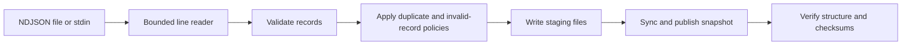

# Dockline

**Deterministic NDJSON imports. Verifiable local snapshots.**

Dockline is a Go command-line tool for turning line-delimited JSON files into
validated, deduplicated datasets. It streams records, applies explicit error
policies, and publishes a completed snapshot with SHA-256 integrity checks.

Use it for event exports, telemetry dumps, or batch data handoffs where malformed
records, duplicate IDs, and partially written output need predictable handling.
Dockline prepares data for another system; it is not a dashboard, database, or
message broker.

**Current scope:** complete imports and snapshot verification. Durable
checkpoints and resumable jobs are on the [roadmap](docs/ROADMAP.md), not
implemented features of this release.

## Quick start

Requirements: Linux, a local filesystem supporting directory sync and atomic
same-filesystem rename, and Go 1.23 or newer. Use a currently supported Go
release for normal development. There are no third-party Go modules or
external services.

```sh
go test ./...
make build

./bin/dockline import \
  --input examples/events.ndjson \
  --output out/events

./bin/dockline verify \
  --snapshot out/events \
  --input examples/events.ndjson
```

The output directory must not already exist. Imports do not overwrite snapshots.

For a repeatable demonstration that cleans up its own temporary files:

```sh
make demo
```

The mixed-input demo produces **2 accepted records**, **1 duplicate**, **1
rejection**, and **1 blank line**, then verifies the snapshot against its source.

## What you get

```text
out/events/
  records.ndjson     accepted records, in source order
  rejected.ndjson    source line numbers and rejection reasons
  manifest.json      options, counters, byte lengths, SHA-256 digests
```

Accepted records stay in NDJSON. Rejection diagnostics do not include the
original rejected payload. The manifest contains no source path or timestamps,
so identical source bytes, options, and tool version produce the same manifest.

## How it works



| Component | Responsibility |
| --- | --- |
| `internal/ndjson` | Physical-line framing, newline handling, oversized-line draining |
| `internal/model` | Record validation, options, counters, snapshot format |
| `internal/engine` | Import policies, duplicate-ID tracking, hashing |
| `internal/snapshot` | Destination ownership, staging, publication, verification |
| `internal/cli` | Flags, input files, JSON summaries, exit codes |
| `cmd/dockline` | Process signals and program exit |

See [Architecture](docs/ARCHITECTURE.md) for invariants and design tradeoffs.

## Record contract

Every nonblank physical line must be a UTF-8 JSON object with unique top-level
keys and a nonblank string `id` of at most 256 UTF-8 bytes. Other fields are
application-defined.

```json
{"id":"event-001","kind":"device.reading","device":"sensor-a","value":21.4}
```

Dockline accepts LF, CRLF, and a final line without a newline. It preserves
number literals, object field order, and the order of accepted records while
compacting insignificant whitespace. Large integers are not converted to
floating point.

IDs are opaque decoded strings: they are not trimmed or Unicode-normalized.
Nested objects use Go's standard JSON semantics; nested duplicate keys are not
rejected. The record-size limit is applied before blank-line classification.

## Import policies

Both policies default to `fail`. To keep the first valid occurrence of each ID
and log malformed lines instead of stopping:

```sh
./bin/dockline import \
  --input examples/mixed.ndjson \
  --output out/mixed \
  --invalid skip \
  --duplicates skip
```

`--invalid skip` writes a line number and reason to `rejected.ndjson`.
`--duplicates skip` increments the duplicate counter without creating a
rejection entry. Invalid records do not reserve their IDs.

| Flag | Default | Purpose |
| --- | --- | --- |
| `--input` | Required | Source path, or `-` for stdin |
| `--output` | Required | New snapshot directory |
| `--invalid` | `fail` | Stop on malformed records, or `skip` |
| `--duplicates` | `fail` | Stop on repeated IDs, or `skip` |
| `--max-record-bytes` | `1048576` | Record limit excluding LF/CRLF; maximum 64 MiB |
| `--timeout` | `0` | Optional command deadline, such as `30s` |

Payloads stream through a bounded line reader. The duplicate-ID index remains
in memory: total memory is **O(unique IDs + maximum record size)**, not constant.

## Verification

```sh
./bin/dockline verify --snapshot out/events
./bin/dockline verify --snapshot out/events --input examples/events.ndjson
```

Default verification checks accepted-record validity and uniqueness, rejection
ordering, count invariants, byte lengths, and output digests. Supplying `--input`
also compares the original source's byte count and SHA-256 fingerprint.

Checksums detect accidental damage. They do not authenticate the producer or
protect against an attacker who can rewrite both data and manifest.
Verification does not replay import policies against the source.

See [Snapshot format](docs/FORMAT.md) for the complete data contract.

## Publication, cancellation, and limits

A cooperating importer reserves the destination, writes into a sibling staging
directory, syncs data and metadata, renames the completed directory, and syncs
the parent. Existing output paths are refused.

SIGINT, SIGTERM, and command deadlines request cooperative cancellation.
Cancellation is checked between records and before publication; it cannot
interrupt an arbitrary blocked reader, including idle stdin. A cancellation
observed before publication cleans up the current staging directory and lock.

Once the rename commits publication, later errors or cancellation do not delete
the snapshot. A summary-output failure may occur after successful publication;
verify the existing snapshot before retrying.

The source must remain unchanged during an import. Dockline does not lock the
source or detect every possible concurrent modification. The publication
contract assumes Linux local filesystem semantics and no external program
mutating the destination during publication. Network filesystems and Windows
are outside the validated contract.

**Abrupt termination:** SIGKILL or a crash may leave staging files and a
destination reservation. This release has no automatic stale-lock takeover,
checkpoint, or resume operation. Establish that the owning process has stopped
before manual cleanup. Never delete an existing completed snapshot as part of
cleanup.

The tested guarantee is process-level publication and cooperative cleanup.
Power-loss durability has not been validated. Sync calls are not proof of
persistence through storage-controller failures or power loss.

## Commands and exit codes

```text
dockline import --input FILE|- --output DIR [policy and size flags]
dockline verify --snapshot DIR [--input FILE]
dockline version
```

| Exit | Meaning |
| --- | --- |
| `0` | Success or successfully written help/version output |
| `1` | Runtime, validation, verification, or output error |
| `2` | Invalid command usage |
| `130` | Cooperative cancellation or deadline |

## Development

```sh
make test       # unit and integration tests
make check      # formatting, go vet, race-enabled tests
make demo       # synthetic mixed input, import, and source verification
make bench      # import throughput and allocation benchmark
make fuzz       # short parser fuzz run
```

Linux subprocess tests exercise both SIGINT and SIGTERM cleanup. The race
detector and fuzzing check executed paths; neither substitutes for crash or
power-loss experiments.

The CI workflow is configured for the minimum Go language baseline and the
current stable Go release on Ubuntu. Its status must come from actual workflow
runs, not from local test results.

Read [Contributing](CONTRIBUTING.md), [Architecture](docs/ARCHITECTURE.md), and the
[Recovery roadmap](docs/ROADMAP.md) before changing persistence behavior.

## Project status

The examples are synthetic and contain no customer or employer data.
This is a standalone engineering project, not a claim of production deployment.
No open-source license has been selected yet.
